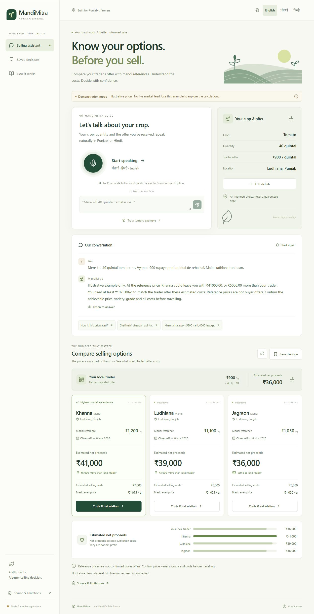
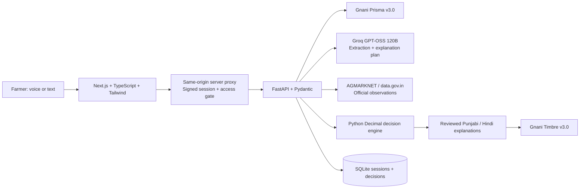

# MandiMitra

**Har Fasal Ka Sahi Sauda.** A voice-first crop-selling decision assistant for Punjab, built for the Gnani AI Great Indian AI Internship Challenge 2026.

MandiMitra turns a crop quantity, a trader offer, reported mandi observations and adjustable selling costs into a transparent comparison of **net proceeds**. It shows the price needed to match the trader after transport, fees and expected produce loss.



## Delivery status

The Next.js frontend and Python/FastAPI backend run locally and communicate through a private server-side proxy. The offline demonstration works with Punjabi, Hindi and code-mixed text, corrections, financial comparisons, cost editing and saved decisions.

**Working prototype with live integrations demonstrated.** During owner-run checks on 10 November 2026, Punjabi voice input, structured extraction, spoken playback, official Punjab tomato observations, cost comparisons, saved decisions and mobile-browser access were demonstrated. The owner also confirmed access-code sign-in through a temporary HTTPS tunnel. These are demonstration checks, not a production reliability or speech-accuracy benchmark. See [live verification](docs/LIVE_VERIFICATION.md) for the testing history. Demo-mode prices are synthetic, prominently labelled and never substituted for failed official requests.

Live market coverage varies by reporting date. The current crop vocabulary covers tomato, potato and wheat; an understood crop can still have no comparable observations. Native-script location matching also needs improvement. Reference prices are not guaranteed offers, and net proceeds exclude cultivation costs.

## Start locally

For a numbered Windows-to-HTTPS walkthrough, start with [setup and deployment, step by step](docs/SETUP_STEP_BY_STEP.md). The optional `scripts/prepare-env.py` helper fills only missing app secrets; it preserves existing nonempty settings. `compose.hosted.yaml` adds automatic HTTPS with Caddy and requires an access code and domain. This hosted configuration still needs its first real Docker/server verification.

Requirements: Python 3.10+ (3.12 recommended), Node.js 24 and npm. From this project directory:

```powershell
python -m venv .venv
.venv\Scripts\python.exe -m pip install -r services\api\requirements.txt
Copy-Item .env.example .env
cd apps\web
npm ci
```

Return to the project root and start both services in local demo mode:

```powershell
cd ..\..
.venv\Scripts\python.exe scripts\dev.py
```

Open **http://localhost:3000**. Ctrl+C stops the processes the launcher started. For local development keep `DEPLOYMENT_ENV=development` and `APP_PUBLIC_URL=http://localhost:3000` in `.env`.

The demonstrated shared site uses a temporary Cloudflare tunnel and is available only while its host computer and services are running. This repository does not promise a permanent hosted endpoint. For a built HTTPS demo, configure the settings described in the setup guide, build the frontend, and run `scripts/serve.py` from the project root.

On macOS/Linux use `.venv/bin/python` in place of `.venv\Scripts\python.exe`. The frontend scripts read the root `.env`; FastAPI loads it automatically. If using `127.0.0.1` instead of `localhost`, set `APP_PUBLIC_URL=http://127.0.0.1:3000` to match exactly. The default without an `.env` accepts both local origins.

## Explore in a minute

1. Choose English, ਪੰਜਾਬੀ or हिन्दी.
2. Select **Try a tomato example**. This explicitly loads fictional tomato observations and sample cost assumptions.
3. The sample compares 40 quintals at ₹900/q with three illustrative Punjab market references. Khanna yields ₹41,000 after ₹7,000 expenses, a ₹5,000 difference; break-even is ₹1,075/q.
4. Open **Costs & calculation**, change transport from ₹5,500 to ₹4,000 and update. Estimated net proceeds become ₹42,500.
5. Say/type **“Chali nahi, chaudah quintal.”** The quantity becomes 14. The ₹12,600 trader baseline now exceeds the alternative estimates under those costs.
6. Save the decision, reopen its immutable snapshot and download/share the complete assumptions and sources.

For a fresh conversation, try:

```text
Mere kol 40 quintal tamatar ne.
900 rupaye
Ludhiana
```

Then confirm the local trader’s assumptions and enter costs for each market. Manual forms remain available when a language provider fails. Demo mode uses a deliberately limited parser, not an LLM pretending to be connected.

## Enable real providers

Set the following **server-only** values in `.env` and restart both services:

| Variable | Purpose |
|---|---|
| `APP_MODE=live` | Enables official data and paid provider calls; disables sample loading |
| `GNANI_API_KEY` | Prisma STT and Timbre TTS authentication |
| `GROQ_API_KEY` | Structured extraction and grounded explanation planning |
| `GROQ_MODEL=openai/gpt-oss-120b` | Replaceable Groq model |
| `DATA_GOV_API_KEY` | Registered data.gov.in API access |
| `AGMARKNET_RESOURCE_ID` | Configurable daily mandi resource; default supplied in `.env.example` |
| `GNANI_TTS_MODEL=timbre-v3.0` | V3 speech synthesis |
| `GNANI_TTS_VOICE=Prakash` | Official V3 voice listed for Punjabi and Hindi; audition before use |
| `API_INTERNAL_TOKEN` | Long random shared credential between Next.js and FastAPI; required for live mode |
| `APP_ACCESS_CODE` | Private demonstration access gate |
| `APP_SESSION_SECRET` | Long random cookie signing secret |
| `APP_PUBLIC_URL` | Exact browser origin, including local port or deployed HTTPS hostname |
| `DATABASE_PATH` | SQLite database location; default `runtime/mandimitra.db` |
| `DEPLOYMENT_ENV=production` | Enforces required deployment security configuration and secure cookies |

Never use `NEXT_PUBLIC_` for secrets. `.env` files, databases and audio are excluded from source control and the delivery archive. The frontend never receives provider keys.

Run live verification deliberately; it can consume provider credits:

```powershell
.venv\Scripts\python.exe scripts/live-smoke.py --allow-paid --wav path/to/punjabi-16khz-mono.wav
```

The script reports each actual outcome separately. A missing key or an unavailable service is a failure, never a mocked success. Test real Punjabi and Hindi recordings, confirm transcriptions and audition generated speech before using the application for the challenge or with farmers.

## Architecture



Financial results never come from the LLM. Quantity and price units are normalized on the backend. Groq selects structured updates and a constrained explanation emphasis; reviewed localized sentences insert only deterministic calculation results. This deliberately limits free-form generation to prevent invented price claims.

SQLite with one API worker is the practical local/small private-demo choice. PostgreSQL and distributed session locking are future deployment work. Docker configuration is supplied for deployment; the owner-tested shared demo used a local server and temporary Cloudflare tunnel.

## Verification

```powershell
.venv\Scripts\python.exe -m pytest
cd apps\web
npm run typecheck
npm run build
```

See [the evaluation report](docs/EVALUATION.md) for the exact executed results and browser coverage, with mocked versus live calls separated. The 16-case multilingual evaluation corpus lives in `data/samples/evaluation.json`; it is not a statistical accuracy benchmark.

With both services running in demo mode, `python scripts/verify-local.py` runs 14 checks through the real frontend proxy using a separate disposable session. It does not invoke paid providers. Set `VERIFY_BASE_URL=http://localhost:3000` if that is your configured origin.

## Project map

```text
apps/web/src/          React interface, audio conversion, translations, private proxy
services/api/app/     Validation, conversation state, decision engine, provider adapters
tests/                Financial, multilingual, provider contract and API tests
data/samples/         Explicitly illustrative market fixtures and evaluation queries
scripts/              Local startup and opt-in live provider smoke test
docs/                 Architecture, sources, API, deployment, evaluation and demo script
compose.yaml          Private local two-service deployment configuration
```

Read [architecture](docs/ARCHITECTURE.md), [data sources](docs/DATA_SOURCES.md), [API reference](docs/API.md), [deployment](docs/DEPLOYMENT.md), [limitations](docs/LIMITATIONS.md) and the [60-second demo script](docs/DEMO.md).
